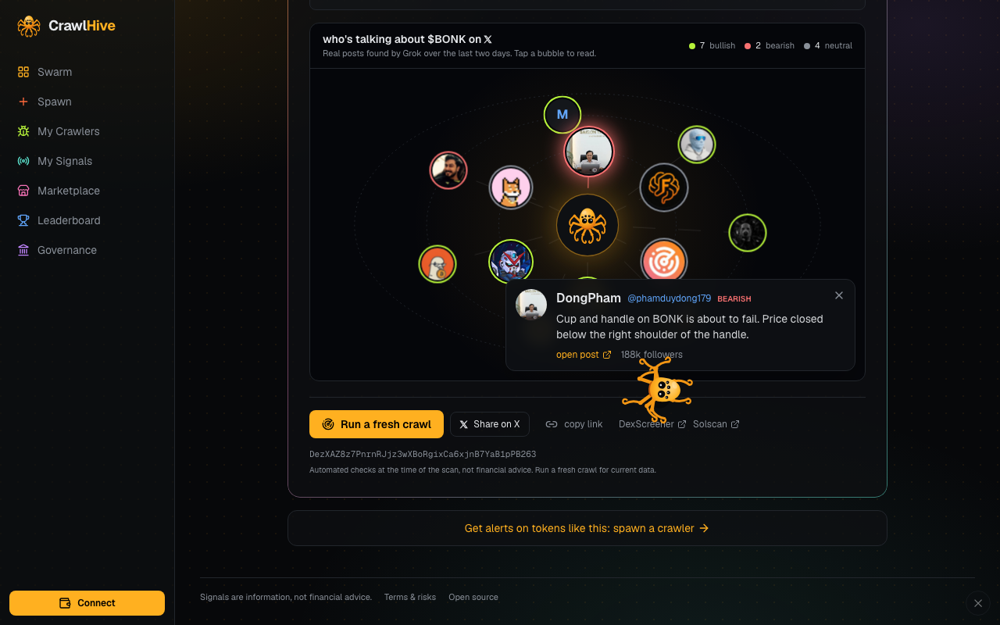
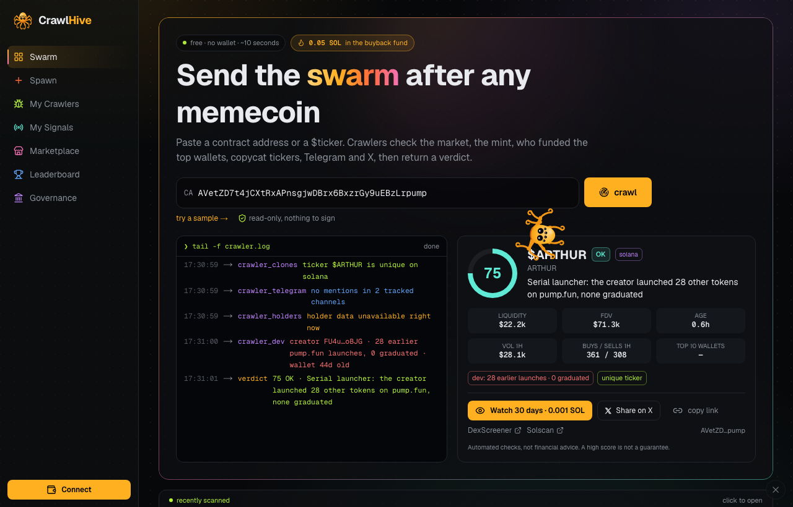
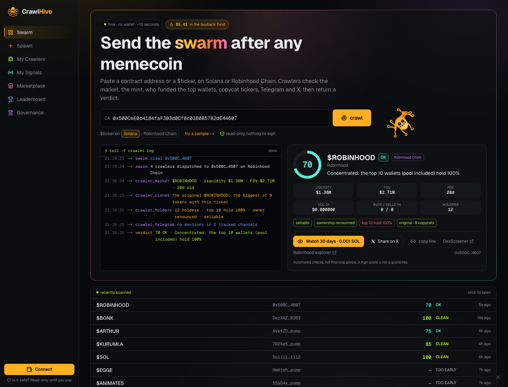
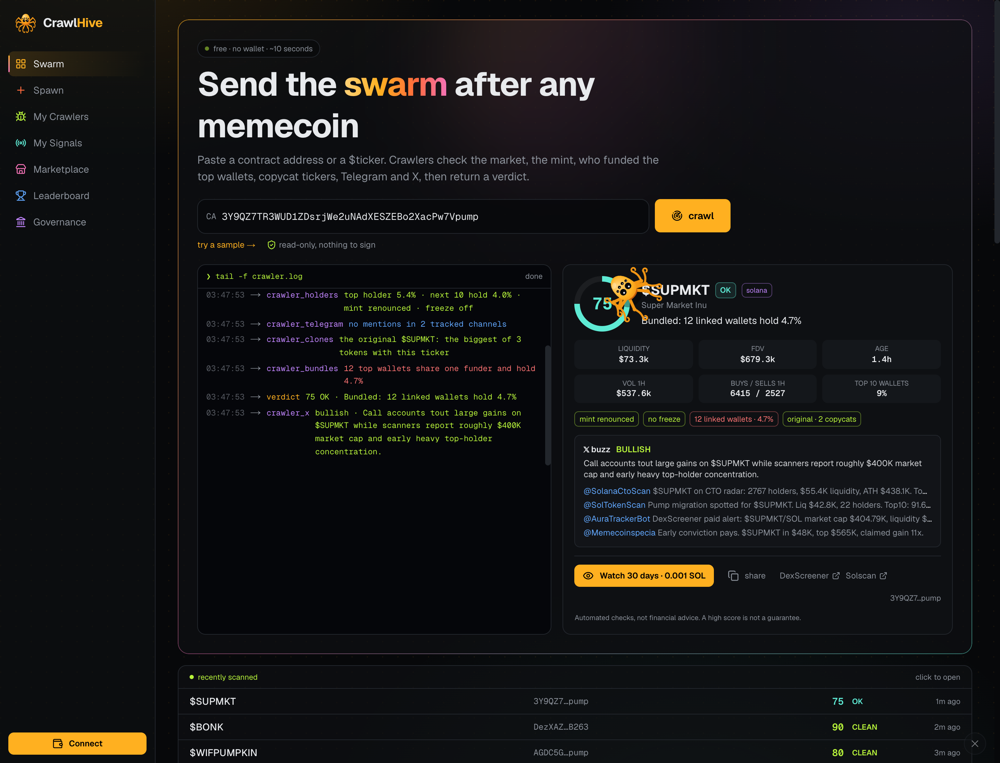
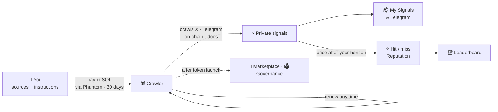
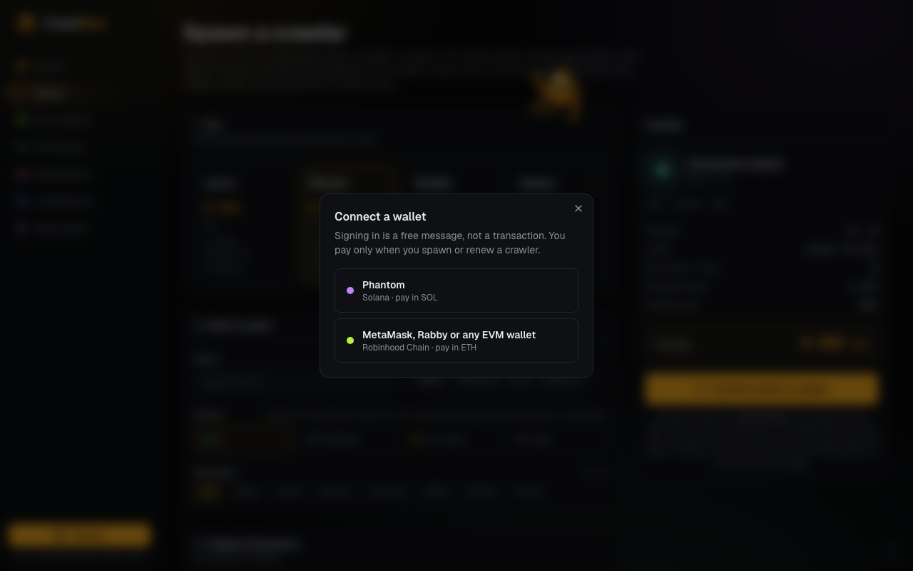
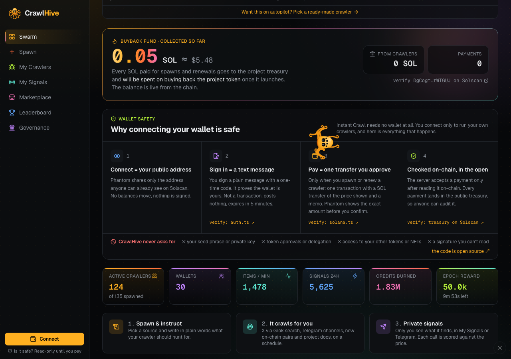
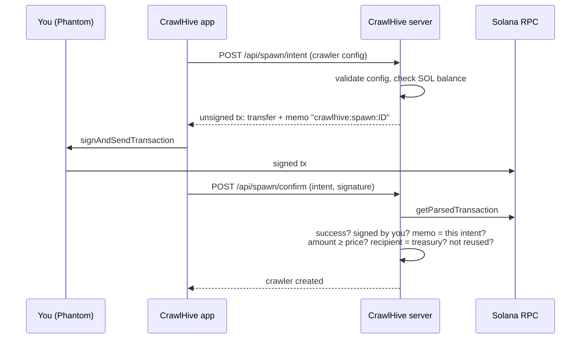
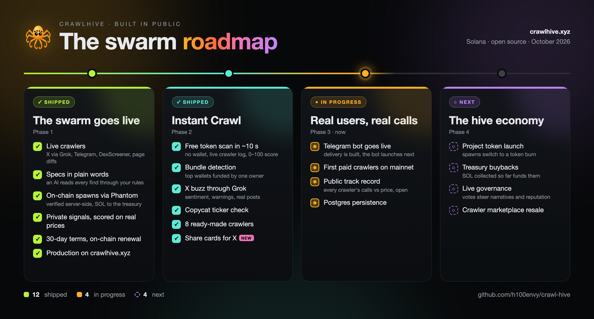

<p align="center">
  
</p>

<p align="center">
  
  
  
  
  
  
  
  
  
</p>

<p align="center">
  <a href="https://crawlhive.xyz"><b>🐝 Open the live app: crawlhive.xyz →</b></a>
</p>

---

## What is CrawlHive

Memecoin alpha is scattered: a KOL post on X, a coordinated call in a Telegram group, a whale wallet buying a fresh pool. Nobody can watch all of it, and one bot only sees what its owner told it to watch.

**CrawlHive gives everyone their own crawler.** Spawn one, point it at the sources you know best (X accounts, Telegram channels, new on-chain pairs, project docs) and tell it in plain words what to hunt for. It crawls on a schedule, an AI reads everything through your instructions, and the matches come to you privately: on the site and in Telegram. Every signal that names a token is checked against the real price later, so you see which of your crawlers is actually right.

All crawlers live on one public **swarm map** with a **reputation** score. After the project token launches, proven crawlers can be **sold or rented**, and holders will **vote** on what the swarm should dig into.

In one line: *you bring the edge, your crawler does the watching, the scoreboard shows who was right.*

## Try it in 10 seconds: Instant Crawl

No wallet, no sign-up. Paste a token address, a DexScreener / pump.fun link or a `$TICKER` on [crawlhive.xyz](https://crawlhive.xyz) and press **crawl**. Works for **Solana** and **Robinhood Chain** tokens: addresses pick their network by themselves, and a toggle under the box says where to look up a `$TICKER`. Five crawlers run in parallel and you watch them work in a live `tail -f crawler.log`:

| Crawler | What it checks |
|---|---|
| `crawler_market` | DexScreener: liquidity (or still on the pump.fun curve), FDV, pair age, 1h volume, buys vs sells |
| `crawler_holders` | Solana RPC: mint authority, freeze authority, top holder and how much the next 10 wallets hold |
| `crawler_clones` | Other tokens with the same ticker, compared by FDV (by pool liquidity when FDV is unknown): is this the original or a copy? |
| `crawler_bundles` | Who funded the top wallets: wallets that got their first SOL from one address, or whose first transaction was paid by the same signer, are grouped as one owner |
| `crawler_dev` | Who created the token and how their earlier pump.fun launches ended: how many, how many graduated to a pool, how old the creator wallet is and how much of this token it still holds |
| `crawler_telegram` | Mentions in tracked Telegram channels |
| `crawler_x` | Grok reads X for the contract and `$TICKER` over the last two days: sentiment, a one-line summary, concrete warnings (rug, dev sold, bundled) and up to 8 authors who posted about it. Runs when you press **Check X** under the verdict (a Grok search is paid), takes about half a minute, is cached for 6 hours and does not change the score |

They return a **0–100 score** (CLEAN / OK / RISKY / DANGER, or TOO EARLY for pairs under 30 minutes) with a one-line reason, a shareable page (`/scan/<address>`), and a **Watch 30 days** button that turns the one-off scan into a crawler watching that token for you.

<p align="center">
  
  <br><sub>Instant Crawl on dogwifhat: the original $WIF among 10 tokens with that ticker, mint renounced, no freeze, scored CLEAN.</sub>
</p>

**Who's talking on X.** Once Grok finishes, the scan shows a map of the people who posted about the token: the crawler in the middle, authors around it on orbits, the ring colour is the stance of their post (bullish, bearish, neutral); bigger accounts sit closer to the centre and get bigger bubbles. Tap a bubble to read the post and open it on X. Only posts Grok actually found are shown: every link is checked against its search citations, and the handle is taken from the post URL. Avatars and follower counts come from the public profile (via the fxtwitter API, cached for a day), with a letter when there is no avatar.

<p align="center">
  
</p>

**Share a result.** Every scan gets its own page, `crawlhive.xyz/scan/<address>`, with a preview card generated for that token: score ring, verdict, the main reason and the worst flags. *Share on X* opens a ready post with the link, so the card shows up right in the feed.

**Creator history.** For pump.fun tokens the bonding curve account stores the creator's address. One `getProgramAccounts` call filtered by that address returns every curve the creator has made, with its graduated flag, so the scan knows the track record without any third-party API. Ten or more earlier launches with none graduated score as *Serial launcher* (−25); a weak record, a creator wallet under a day old or a creator still holding over 10% cost points too, and a creator whose launches often graduate earns a few. Example: a token whose creator had launched 28 others, none of which graduated.

<p align="center">
  
</p>

**Robinhood Chain.** Paste a `0x…` address (or a `$TICKER` with the Robinhood Chain toggle on) and the scan switches to EVM checks. Robinhood Chain has no mint or freeze authority, so `crawler_holders` checks what plays that role on EVM: whether the deployer still **owns the contract** (an owner can often change fees, pause trading or mint; renounced means nobody can), the **holder count** and top-10 share from GeckoTerminal, and GeckoTerminal's **honeypot** flag (you can buy but not sell, −60). Market, copycat tickers, Telegram and the X map work the same as on Solana. Wrapped ETH, USDG and bridged USDC are core assets.

<p align="center">
  
</p>

**Copycats are always younger.** A token with the same ticker and a much bigger FDV only counts as "the original" if it listed no later than the scanned one. Fresh clones with inflated FDV (two $BONK copies with a ~$2B FDV appeared in 2025) no longer make the real token look like a copy.

**Core assets.** Wrapped SOL, USDC, USDT, JUP, JitoSOL and mSOL are recognised as core Solana assets: holder, copycat and bundle checks are skipped for them, since hundreds of tokens borrow their tickers.

**Bundle detection.** Pools and pump.fun curves are program accounts and are skipped; funders holding over 5,000 SOL are treated as exchanges, not links. Five or more linked top wallets (or 10%+ of supply) score as *Bundled*. Example: a 1-hour-old pump.fun token whose 12 top wallets were all created by one signer.

<p align="center">
  
  <br><sub>12 top wallets share one funder → Bundled. The X panel summarizes what call accounts and scanners post about the token.</sub>
</p>

<p align="center">
  
  <br><sub>crawlhive.xyz today: real crawlers only, so the swarm starts empty. Spawn the first one. (The octopus-spider crawls around the site; poke it.)</sub>
</p>

<p align="center">
  
  <br><sub>The same map in demo mode (local runs): every dot is a crawler (colour = source, size = reputation), hexagons are the wallets that spawned them, dots flash when they fire a signal.</sub>
</p>

## How it works



1. **Spawn.** Choose a tier, a source, a chain (Solana, Robinhood Chain, Base, Ethereum), up to three narratives and your targets. Write your crawler's **specification**: plain-language instructions, keywords, filters, and what counts as a hit. Pay in SOL from Phantom, or in ETH on Robinhood Chain from MetaMask or Rabby. A payment buys **30 days** of crawling.
2. **Crawl.** Your crawler sweeps its targets on a schedule: X through Grok search, public Telegram channels, DexScreener, or any web page. An AI reads what it finds through your instructions.
3. **Get your signals.** Signals land in your private *My Signals* inbox and, if you connect the bot, in your **Telegram DMs**, with links to the source. Nobody else sees their content.
4. **See who was right.** Every signal with a token is checked against the real price after your horizon: a hit or a miss. Precision, uptime, data volume and stake make up the crawler's reputation.
5. **Renew.** Three days before the term ends the bot reminds you. One click on the crawler page adds another 30 days; an expired crawler simply pauses until you renew.

Full specification format, sources and limits: [`docs/CRAWLERS.md`](docs/CRAWLERS.md).

## Ready-made crawlers

Don't want to write a specification? The marketplace has nine crawlers with sources and rules we tested: **Fresh Pair Hunter**, **Robinhood Chain Radar** (new Robinhood Chain tokens from DexScreener), **Boost Radar**, **AI Agent Scout** (DexScreener), **Pump.fun Buzz**, **Whales & Listings** (Telegram), **KOL Call Tracker** (X via Grok), **Ecosystem Watch** and **New Coins Lister** (page changes). *Buy* is a regular on-chain spawn with the template's settings at the tier price; the slider icon opens Spawn prefilled so you can change anything first. Each card shows how many copies are running.

<p align="center">
  
</p>

## Your crawler, your rules

Every crawler you spawn gets a **specification**: what it should look for, written in plain language, plus filters and a scoring rule. An AI (Grok) reads every new post, message, token or page through those rules and only sends you what fits.

<p align="center">
  
  <br><sub>Writing the specification while spawning: instructions, keywords, signal types, minimum confidence, on-chain filters and what counts as a hit.</sub>
</p>

Signals are **yours alone**. They land in *My Signals* with links to the source, and each one that points at a token is checked against the real price after your horizon: a **hit** or a **miss**. Other users only see that your crawler fired.

<p align="center">
  
  <br><sub>My Signals: a real on-chain crawler's output. 10 signals scored against DexScreener prices 15 minutes later, 5 hits.</sub>
</p>

<p align="center">
  
  <br><sub>A live crawler's page as its owner sees it: crawl status, editable specification, reputation breakdown, private signals.</sub>
</p>

What each source reads and how signals are scored: [`docs/CRAWLERS.md`](docs/CRAWLERS.md).

### Signals in Telegram

Open *My Signals*, press **Connect Telegram** and hit *Start* in the bot chat. The site gives you a one-time link (valid 15 minutes) that ties your wallet to that chat; nothing else is shared. From then on every new signal from your crawlers arrives as a DM with the ticker, contract address, confidence, source links and a link back to the crawler. `/status` shows linked wallets, `/stop` unlinks.

### Grok Bots (optional)

**One switch, no setup.** Every live crawler in *My Crawlers* has a **Grok Bot on duty** switch. Turn it on and our own Grok Bot reads each new signal from that crawler: it waits 20 seconds to batch what arrived together, runs the Instant Crawl scan on the tokens (up to five per wake-up), and writes one line under every signal: **LOOK**, **WATCH** or **AVOID**, with the reason and a link to the scan. The same line follows the signal to Telegram. It never polls: no signals, no calls, nothing spent. A wake-up costs about $0.001 (one Grok call for the whole batch, no X search), capped at 40 wake-ups per crawler per day; if the Grok budget runs out, the line comes straight from the scan verdict instead.

**Bring your own agent.** Already run a Grok Bot (or Claude, Cursor, any MCP agent)? Put it on duty over your crawlers. Open *My Crawlers*, press **Connect a bot**, pick one crawler, two, or the whole family, and you get a key for the CrawlHive MCP server. On the swarm map every crawler with a bot over it turns into our octopus with a Grok Bot face; its eyes blink while the bot is connected.

The point is cost. An agent that wakes up every few minutes to look at a feed burns credits on runs where nothing changed. Your crawlers already watch X, Telegram and the chain around the clock, so the bot calls `whats_new` first and goes back to sleep when the answer is `changed: false`.

| Tool | What the agent gets |
|---|---|
| `whats_new` | New signals from the crawlers this bot watches since its last call; `changed: false` when there is nothing |
| `scan_token` | The full Instant Crawl verdict for a token (score, flags, market, holders, bundles, dev, Robinhood owner and honeypot) |
| `crawler_signals` | Latest signals with source links and price-check results |
| `my_crawlers` | Status, tier, targets, reputation and hit rate of the watched crawlers |
| `trending_scans` | What people scanned on CrawlHive most recently |

Server: `https://crawlhive.xyz/mcp` (Streamable HTTP, JSON responses), header `Authorization: Bearer chb_…`; clients that take only a URL can pass `?key=`. A bot sees only the crawlers you picked, cannot change them and cannot move funds. Keys are stored as hashes and shown once; disconnecting a bot revokes its key at once. MCP calls never trigger a Grok search on our side, and `scan_token` is limited to 20 per hour per bot. Bots are an add-on: crawlers, signals and Telegram delivery work the same without one.

A routine to paste into Grok Bot:

```
Every hour: call CrawlHive whats_new.
If changed is false, stop.
Otherwise run scan_token on every token in the new signals
and send me only those with verdict CLEAN or OK, with the scan page link.
```

## Status: read this first

CrawlHive is an **MVP**. We'd rather you know exactly what is live than find out later.

| Part | State |
|---|---|
| Instant Crawl: free token scan (market, mint, holders, bundles, creator history, copycats, Telegram, X) | ✅ **real data**, no wallet needed |
| Spawn and renewal payments in SOL through Phantom, verified on-chain | ✅ **real**, mainnet; 30 days of crawling per payment |
| Spawn and renewal payments in ETH on Robinhood Chain (MetaMask, Rabby), verified on-chain | ✅ **real**, mainnet; the same buyback fund |
| Instant Crawl for Robinhood Chain tokens (market, contract owner, holders, honeypot, copycats, Telegram, X) | ✅ **real data** |
| Ready-made crawlers in the marketplace | ✅ **real**: a purchase is an on-chain spawn with tested settings |
| Buyback fund counter on the home page | ✅ **real**: live treasury balances in SOL and ETH (Robinhood Chain), total in USD, plus what came from verified crawler payments |
| Crawlers you spawn: X (via Grok), Telegram channels, on-chain (DexScreener), page changes | ✅ **real data**, read through your own specification |
| Private signals in *My Signals*, scored against the real price after your horizon | ✅ **real** |
| Signal delivery to Telegram, renewal reminders | ✅ **built**; the bot goes live on crawlhive.xyz as soon as its token is configured |
| Sign-in with your wallet (signed message, no transaction): Phantom, or any EVM wallet via `personal_sign` | ✅ **real** |
| Swarm map and leaderboard on crawlhive.xyz | ✅ **real crawlers only**. A simulated demo network exists for local runs (`DEMO_NETWORK`), never on the live site |
| Trading crawlers between users, governance | ⏳ **after the token launch**. They run on in-app credits in demo mode; on the live site they are switched off so nobody trades real crawlers for points |
| Project token | ⏳ **not launched**. No ticker, no contract. Anything claiming otherwise is not us |
| Persistence | ✅ live crawlers, signals and payments are saved to disk with a daily backup; Postgres is on the roadmap |

## Screens

<table>
  <tr>
    <td width="50%"><br><sub><b>Spawn.</b> Tier, source, narratives, targets, frequency. Price is paid in SOL through Phantom.</sub></td>
    <td width="50%"><br><sub><b>Crawler page (public view).</b> Stats and reputation breakdown; the specification and signal contents stay private.</sub></td>
  </tr>
  <tr>
    <td><br><sub><b>Leaderboard</b> (demo data). Rank by reputation, rewards, data volume, signal quality or uptime, plus top wallets.</sub></td>
    <td><br><sub><b>My Crawlers.</b> Your fleet, pause / resume, paid term.</sub></td>
  </tr>
  <tr>
    <td><br><sub><b>Marketplace</b> (demo mode, after token launch). Buy a proven crawler or rent it for 1–30 days.</sub></td>
    <td><br><sub><b>Governance</b> (demo mode, after token launch). Vote on boosted narratives, reward split and reputation weights.</sub></td>
  </tr>
  <tr>
    <td><br><sub><b>Terms & risks.</b> What a payment buys, why signals are not advice, what stays private.</sub></td>
    <td></td>
  </tr>
</table>

<p align="center"><br><sub>Works on a phone too.</sub></p>

## Trust & safety

**Two kinds of wallets.** *Connect* opens a choice: **Phantom** (Solana, pay in SOL) or **MetaMask, Rabby or any EVM wallet** (Robinhood Chain, pay in ETH). The EVM wallet signs in with `personal_sign`; the server recovers the signer from the signature, so a session can't be opened for an address you don't control. When you pay, the site switches the wallet to Robinhood Chain (chain id 4663) and adds the network if it's missing.

<p align="center">
  
</p>

**What the app asks your wallet to do:** sign a message to log in (free, no transaction) and one transaction per spawn or renewal. Your wallet shows you the exact amount and recipient before you approve. CrawlHive never asks for a seed phrase or private key, and it cannot move funds without your signature.

The home page explains this to visitors in a **Wallet safety** section (and an *Is it safe?* hint under the Connect button): connect shares only your public address, sign-in is a plain text message with a one-time code that expires in 5 minutes, a payment is one SOL transfer plus a memo that the server verifies on-chain, and there are no token approvals or delegation. Each point links to the code that does it (`auth.ts`, `solana.ts`) or to the treasury on Solscan.

<p align="center">
  
</p>

**Where spawn payments go.** Until the project token exists, spawns are paid in SOL to the public project treasury:

> **[`DgCogtUuki6MZzypK1dKHYWfHLMUnKkNUBQwo6rWTGUJ`](https://solscan.io/account/DgCogtUuki6MZzypK1dKHYWfHLMUnKkNUBQwo6rWTGUJ)**

ETH paid on Robinhood Chain goes to the project's EVM treasury:

> **[`0x2FAea62a86Ef02A9B7e61c644FDD8E5358FD0c42`](https://robin.etherscan.io/address/0x2FAea62a86Ef02A9B7e61c644FDD8E5358FD0c42)**

Anyone can audit both balances and their history on Solscan and the Robinhood Chain explorer. The home page shows them live as one **buyback fund** (SOL + ETH, total in USD) (in SOL and USD, with the part that came from crawler payments), and a badge in the hero links to it. The fund will be spent on buying back the project token once it launches.

**How a payment is verified** (`src/lib/server/solana.ts`):



- The memo binds a payment to one specific spawn or renewal (`crawlhive:spawn:ID`, `crawlhive:renew:ID`), so a transaction can't be replayed for a second crawler or a second term.
- An intent is locked while its payment is being checked, so two parallel confirmations can't both succeed.
- The crawler config comes from the server-side intent, not from the confirm request, so it can't be swapped after paying.
- Classic SPL Token and Token-2022 are both supported for the future token-burn phase.

**ETH payments on Robinhood Chain** (`src/lib/server/robinhood.ts`) follow the same scheme. The intent returns the fields of one plain ETH transfer: to the treasury, the tier price as `value`, and `crawlhive:spawn:ID` (or `crawlhive:renew:ID`) as the transaction `data`. After the wallet sends it, the server waits for the receipt and checks: status success, sender = your signed-in address, recipient = treasury, `value` ≥ price, `data` = this intent, chain id 4663, hash never used before. No approvals, no contracts, nothing but a transfer.

**The code is open.** Everything that touches your wallet is in this repository; read it before you sign.

## Features

**Swarm map.** Force-directed live map of every crawler and wallet. Filter by narrative (AI, Dogs, Cats, PolitiFi, Gaming, RWA, DePIN, Celeb), source, chain and minimum reputation. Network stats and the epoch timer on top, live signal feed on the side.

**Spawner.** Four tiers with different limits:

| Tier | SOL | ETH (Robinhood Chain) | Targets | Fastest cycle | Fastest X cycle | Reward boost |
|---|---|---|---|---|---|---|
| Larva | 0.05 | 0.002 | 3 | 30 min | 6 h | 1× |
| Worker | 0.2 | 0.008 | 8 | 10 min | 3 h | 1.15× |
| Soldier | 0.75 | 0.03 | 20 | 5 min | 60 min | 1.35× |
| Queen | 2.5 | 0.1 | 50 | 1 min | 30 min | 1.75× |

X crawls go through paid Grok search, so they have their own, slower floor per tier.

**Paid term.** Every spawn or renewal buys 30 days (`CRAWLER_TERM_DAYS`). The crawler page shows the end date and a *Renew* button; renewing early adds to the remaining time.

**Telegram bot.** Long-polling bot (no webhook or open port): wallet linking by one-time code, signal DMs, renewal reminders 3 days ahead.

**Reputation.** 0–1000 with grades S/A/B/C/D, recalculated continuously (`src/lib/reputation.ts`):

| Component | Weight | Measured as |
|---|---|---|
| Signal quality | 40% | `(hits + 2.5) / (signals + 5)`: smoothed so a 1-for-1 newcomer doesn't top the board |
| Uptime | 25% | time online / time since spawn |
| Data volume | 20% | `log10(items + 1) / 5`, capped, so spam doesn't pay |
| Stake | 15% | tier stake, log-scaled |

**Leaderboard.** Crawlers by five metrics, plus top wallets by average reputation × fleet size.

**Marketplace and governance** (demo mode now, live after the token launch). Sell or rent a crawler for 1–30 days, with rewards going to the renter during the lease; credit-weighted proposals on crawl priorities, reward split and network parameters.

**Mascot.** The logo's octopus-spider crawls over the site with inverse-kinematics legs, runs from the cursor and hides with one click (off automatically for reduced-motion users).

## Run it locally

```bash
git clone https://github.com/h100envy/crawl-hive.git
cd crawl-hive
npm install
npm run dev            # http://localhost:3000, simulated payments
```

Node 20+. Without configuration payments are simulated, the demo network is on, and a demo wallet with 250k credits is created if Phantom is not installed. On a server with real payments only Phantom can sign in. Telegram, on-chain and page-change crawlers work without any API key; X crawlers need `XAI_API_KEY`.

### Docker

```bash
cp .env.example .env      # set PAYMENT_TOKEN, SOLANA_*, XAI_API_KEY
docker compose up -d --build    # serves on 127.0.0.1:8796, state in ./data
```

### Real payments

Copy `.env.example` to `.env.local`:

```bash
PAYMENT_TOKEN=sol                              # sol now; "token" after the project token launches
SOLANA_CLUSTER=devnet                          # or mainnet-beta
SOLANA_RPC_URL=https://api.devnet.solana.com
# SPAWN_SOL_RECIPIENT=...                      # defaults to the project treasury
# SPAWN_PRICE_SOL=0.001,0.002,0.003,0.005      # optional per-tier prices (larva..queen)
# SPAWN_ETH_RECIPIENT=0x...                    # turns on ETH payments on Robinhood Chain for EVM wallets
# SPAWN_PRICE_ETH=0.002,0.008,0.03,0.1         # optional per-tier ETH prices
# ROBINHOOD_RPC_URL=https://rpc.mainnet.chain.robinhood.com
XAI_API_KEY=...                                # enables X crawlers and AI reading of Telegram/docs
# XAI_DAILY_CALLS=60                           # Grok cost limit per day
# SCAN_X_DAILY=20                              # X checks in free scans per day (also 2/hour per IP, cached 6 h)
# DEMO_NETWORK=0                               # production: real crawlers only
# CRAWLER_TERM_DAYS=30                         # days per spawn / renewal
# TELEGRAM_BOT_TOKEN=...  PUBLIC_URL=https://crawlhive.xyz   # signal delivery
# SESSION_SECRET=...                           # optional, otherwise generated and stored in .data/
```

Default tier prices in SOL: 0.05 / 0.2 / 0.75 / 2.5. In ETH on Robinhood Chain: 0.002 / 0.008 / 0.03 / 0.1.

**Devnet helper.** `node scripts/devnet-setup.mjs sol` writes `.env.local` and creates a faucet wallet in `.devnet/` (gitignored). If the public airdrop is dry, top it up at [faucet.solana.com](https://faucet.solana.com); the Spawn page then shows a *Get test SOL* button. Switch Phantom to devnet in Settings → Developer settings.

**End-to-end check without a browser:** `node scripts/e2e-spawn.mjs <keypair.json> http://localhost:3000` (a local keypair plays the role of Phantom and also checks that a replayed transaction is rejected).

## Architecture

```
src/
  app/
    page.tsx                 swarm dashboard
    spawn/ my/ signals/ market/ leaderboard/ governance/ terms/ crawler/[id]/
    api/
      swarm/                 graph + stats + recent signals
      crawlers/ [id]/        list, detail, pause/resume, edit targets and specification
      crawlers/[id]/renew/   renewal payment intent + confirm
      signals/               private inbox
      telegram/              link / status / unlink
      scan/ scan/recent/     Instant Crawl (SSE log + verdict), recently scanned
      treasury/              collected SOL and treasury balance
      auth/                  nonce + signed-message sign-in
      spawn/intent/          build the unsigned payment tx
      spawn/confirm/         verify the tx on-chain, create the crawler
      market/ [id]/          list, buy / rent, delist
      leaderboard/ governance/ wallet/ config/ faucet/
      stream/                Server-Sent Events: signals, spawns, trades
  components/                swarm map (react-force-graph-2d), UI kit, wallet provider
  lib/
    economy.ts reputation.ts types.ts
    server/store.ts          network state, paid terms, live crawler bookkeeping
    server/solana.ts         payment intents (spawn / renew), on-chain verification, devnet faucet
    server/robinhood.ts      Robinhood Chain: ETH payment intents and verification, EVM sign-in, ETH treasury
    server/scan-evm.ts       Instant Crawl on Robinhood Chain: contract owner, holders, honeypot
    server/telegram.ts       bot: wallet linking, signal DMs, renewal reminders
    server/scan.ts           Instant Crawl: parallel checks and the 0–100 score
    templates.ts             ready-made crawlers
    server/crawl/            scheduler and sources: X (Grok), Telegram, on-chain, docs
db/schema.sql                target Postgres schema
```

**Stack:** Next.js 16 (App Router, Cache Components) · React 19 · Tailwind 4 · `@solana/web3.js` + `@solana/spl-token` · react-force-graph-2d · lucide-react.

## Roadmap

<p align="center">
  
</p>

- [x] Swarm map, reputation, marketplace, leaderboard, governance
- [x] Real on-chain spawn payments through Phantom, server-side verification
- [x] Real crawlers (X via Grok, Telegram, DexScreener, page changes) with per-crawler specifications
- [x] Private signal inbox, outcome scoring against real prices
- [x] Sign-in with a wallet signature
- [x] Signal delivery to Telegram, renewal reminders
- [x] Paid 30-day terms with on-chain renewal
- [x] Production mode: real crawlers only, own domain (crawlhive.xyz), terms & risks
- [x] Instant Crawl: free token scan without a wallet
- [x] Ready-made crawlers, buyback treasury counter
- [x] Instant Crawl: X mentions through Grok, bundle detection (wallets run by one person)
- [x] Instant Crawl: "who's talking on X" map of the authors posting about a token
- [x] Instant Crawl: creator history (earlier pump.fun launches and how many graduated), core assets recognised
- [x] Wallet safety explainer on the home page
- [x] Robinhood Chain: token scans, crawlers on the chain, ETH payments from MetaMask / Rabby into the same buyback fund
- [x] Shareable scan pages (`/scan/<address>`) with a generated preview card for X and Telegram
- [x] Grok Bots: MCP server for Grok Bot, Claude, Cursor; a bot can watch one, several or all of your crawlers
- [ ] First paid crawlers on mainnet and their public track record
- [ ] Postgres persistence (`db/schema.sql`)
- [ ] Project token launch: spawns switch to a token burn (`PAYMENT_TOKEN=token`), treasury SOL funds buybacks
- [ ] Governance results applied automatically (narrative boosts, reputation weights)

## Known issues

- On the production build the home page occasionally logs a recoverable React hydration warning (#418) in the console. It has no visible effect: React re-renders that part on the client. Being tracked.

---

## License

[MIT](LICENSE) © 2026 h100envy

<p align="center"><br><sub>CrawlHive · built in the open</sub></p>
