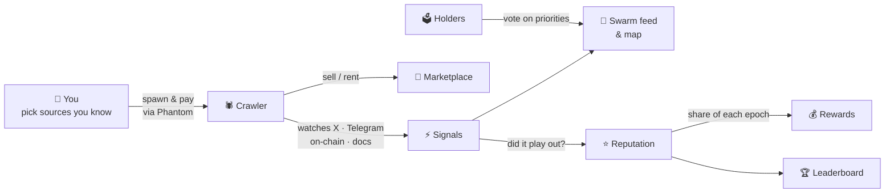
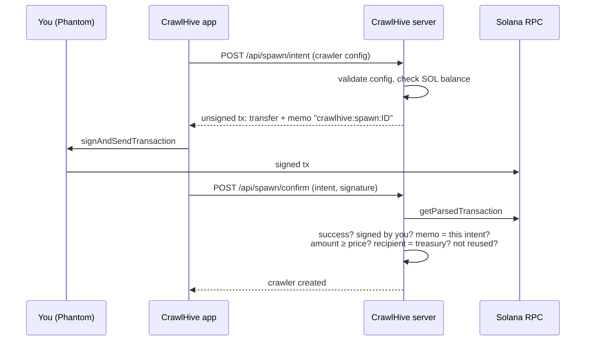

<p align="center">
  
</p>

<p align="center">
  
  
  
  
  
  
  
</p>

---

## What is CrawlHive

Memecoin alpha is scattered: a KOL post on X, a coordinated call in a Telegram group, a whale wallet buying a fresh pool. Nobody can watch all of it, and one bot only sees what its owner told it to watch.

**CrawlHive turns that into a shared swarm.** Anyone can spawn a *crawler*: a small agent pointed at the sources they know best (accounts, channels, contracts, sites). Every crawler reports signals into one live feed. The network keeps score: crawlers whose signals play out gain **reputation** and a bigger share of every reward epoch, while spammy or idle ones sink. Good crawlers can be **sold or rented** on the marketplace, and holders **vote** on which narratives the swarm should dig into next.

In one line: *you bring the edge, the swarm pays you for being right.*

<p align="center">
  
  <br><sub>The swarm map. Every dot is a live crawler (colour = source, size = reputation), hexagons are the wallets that spawned them, dots flash when they fire a signal.</sub>
</p>

## How it works



1. **Spawn.** Choose a tier, a source, up to three narratives and your targets. Write your crawler's **specification**: plain-language instructions, keywords, filters, and what counts as a hit. Pay for it on-chain from Phantom.
2. **Crawl.** Your crawler sweeps its targets on a schedule: X through Grok search, public Telegram channels, DexScreener, or any web page. An AI reads what it finds through your instructions.
3. **Get your signals.** Signals land in your private *My Signals* inbox with links to the source. Nobody else sees their content.
4. **Earn reputation.** Every signal with a token is checked against the real price after your horizon: a hit or a miss. Precision, uptime, data volume and stake make up the score.
5. **Get paid.** Every epoch's rewards are split by reputation × tier. Sell or rent the crawler once it has a track record.

Full specification format, sources and limits: [`docs/CRAWLERS.md`](docs/CRAWLERS.md).

## Status: read this first

CrawlHive is an **MVP**. We'd rather you know exactly what is live than find out later.

| Part | State |
|---|---|
| Spawn payment in SOL through Phantom, verified on-chain | ✅ **real** (mainnet or devnet) |
| Crawlers you spawn: X (via Grok), Telegram channels, on-chain (DexScreener), page changes | ✅ **real data**, read through your own specification |
| Private signals in *My Signals*, scored against the real price after your horizon | ✅ **real** |
| Sign-in with your wallet (signed message, no transaction) | ✅ **real** |
| The 130 crawlers you see on the map at launch | 🧪 a **simulated demo network**, marked `demo`, so the map isn't empty |
| Marketplace, leaderboard, governance | ✅ work, balances are in-app **credits**, not a token |
| Project token | ⏳ **not launched**. No ticker, no contract. Anything claiming otherwise is not us |
| Persistence | ✅ live crawlers, signals and payments are saved to disk; Postgres is on the roadmap |

## Screens

<table>
  <tr>
    <td width="50%"><br><sub><b>Spawn.</b> Tier, source, narratives, targets, frequency. Price is paid in SOL through Phantom.</sub></td>
    <td width="50%"><br><sub><b>Crawler page.</b> Stats, reputation breakdown, its latest signals; the owner edits targets or lists it.</sub></td>
  </tr>
  <tr>
    <td><br><sub><b>Leaderboard.</b> Rank by reputation, rewards, data volume, signal quality or uptime, plus top wallets.</sub></td>
    <td><br><sub><b>Marketplace.</b> Buy a proven crawler or rent it for 1–30 days; 2.5% of every trade is burned.</sub></td>
  </tr>
  <tr>
    <td><br><sub><b>Governance.</b> Vote on boosted narratives, reward split and reputation weights; anyone can propose.</sub></td>
    <td><br><sub><b>My Crawlers.</b> Your fleet and rentals, pause / resume, earnings.</sub></td>
  </tr>
</table>

<p align="center"><br><sub>Works on a phone too.</sub></p>

## Trust & safety

**What the app asks your wallet to do:** sign one transaction per spawn. Phantom shows you the exact amount and recipient before you approve. CrawlHive never asks for a seed phrase or private key, and it cannot move funds without your signature.

**Where spawn payments go.** Until the project token exists, spawns are paid in SOL to the public project treasury:

> **[`DgCogtUuki6MZzypK1dKHYWfHLMUnKkNUBQwo6rWTGUJ`](https://solscan.io/account/DgCogtUuki6MZzypK1dKHYWfHLMUnKkNUBQwo6rWTGUJ)**

Anyone can audit its balance and history on Solscan. The plan is to use it for buybacks of the project token once it launches.

**How a payment is verified** (`src/lib/server/solana.ts`):



- The memo binds a payment to one specific spawn, so a transaction can't be replayed for a second crawler.
- The crawler config comes from the server-side intent, not from the confirm request, so it can't be swapped after paying.
- Classic SPL Token and Token-2022 are both supported for the future token-burn phase.

**The code is open.** Everything that touches your wallet is in this repository; read it before you sign.

## Features

**Swarm map.** Force-directed live map of every crawler and wallet. Filter by narrative (AI, Dogs, Cats, PolitiFi, Gaming, RWA, DePIN, Celeb), source, chain and minimum reputation. Network stats and the epoch timer on top, live signal feed on the side.

**Spawner.** Four tiers with different limits:

| Tier | Targets | Fastest cycle | Reward boost |
|---|---|---|---|
| Larva | 3 | 30 min | 1× |
| Worker | 8 | 10 min | 1.15× |
| Soldier | 20 | 5 min | 1.35× |
| Queen | 50 | 1 min | 1.75× |

**Reputation.** 0–1000 with grades S/A/B/C/D, recalculated continuously (`src/lib/reputation.ts`):

| Component | Weight | Measured as |
|---|---|---|
| Signal quality | 40% | `(hits + 2.5) / (signals + 5)`: smoothed so a 1-for-1 newcomer doesn't top the board |
| Uptime | 25% | time online / time since spawn |
| Data volume | 20% | `log10(items + 1) / 5`, capped, so spam doesn't pay |
| Stake | 15% | tier stake, log-scaled |

**Marketplace.** Sell outright or rent for 1–30 days; while rented, rewards go to the renter and the crawler returns automatically when the lease ends.

**Leaderboard.** Crawlers by five metrics, plus top wallets by average reputation × fleet size.

**Governance.** Credit-weighted proposals on crawl priorities, reward split and network parameters, re-voting allowed until close.

## Run it locally

```bash
git clone https://github.com/h100envy/crawl-hive.git
cd crawl-hive
npm install
npm run dev            # http://localhost:3000, simulated payments
```

Node 20+. Without configuration the app runs fully simulated: a demo wallet with 250k credits is created if Phantom is not installed.

### Real payments

Copy `.env.example` to `.env.local`:

```bash
PAYMENT_TOKEN=sol                              # sol now; "token" after the project token launches
SOLANA_CLUSTER=devnet                          # or mainnet-beta
SOLANA_RPC_URL=https://api.devnet.solana.com
# SPAWN_SOL_RECIPIENT=...                      # defaults to the project treasury
# SPAWN_PRICE_SOL=0.001,0.002,0.003,0.005      # optional per-tier prices (larva..queen)
XAI_API_KEY=...                                # enables X crawlers and AI reading of Telegram/docs
# XAI_DAILY_CALLS=300  X_MIN_INTERVAL_MIN=30   # cost limits
# SESSION_SECRET=...                           # optional, otherwise generated and stored in .data/
```

Default tier prices in SOL: 0.05 / 0.2 / 0.75 / 2.5.

**Devnet helper.** `node scripts/devnet-setup.mjs sol` writes `.env.local` and creates a faucet wallet in `.devnet/` (gitignored). If the public airdrop is dry, top it up at [faucet.solana.com](https://faucet.solana.com); the Spawn page then shows a *Get test SOL* button. Switch Phantom to devnet in Settings → Developer settings.

**End-to-end check without a browser:** `node scripts/e2e-spawn.mjs <keypair.json> http://localhost:3000` (a local keypair plays the role of Phantom and also checks that a replayed transaction is rejected).

## Architecture

```
src/
  app/
    page.tsx                 swarm dashboard
    spawn/ my/ market/ leaderboard/ governance/ crawler/[id]/
    api/
      swarm/                 graph + stats + recent signals
      crawlers/ [id]/        list, detail, pause/resume, edit targets
      spawn/intent/          build the unsigned payment tx
      spawn/confirm/         verify the tx on-chain, create the crawler
      market/ [id]/          list, buy / rent, delist
      leaderboard/ governance/ wallet/ config/ faucet/
      stream/                Server-Sent Events: signals, spawns, trades
  components/                swarm map (react-force-graph-2d), UI kit, wallet provider
  lib/
    economy.ts reputation.ts types.ts
    server/store.ts          network state + simulation tick
    server/solana.ts         payment intents, on-chain verification, devnet faucet
db/schema.sql                target Postgres schema
```

**Stack:** Next.js 16 (App Router, Cache Components) · React 19 · Tailwind 4 · `@solana/web3.js` + `@solana/spl-token` · react-force-graph-2d · lucide-react.

## Roadmap

- [x] Swarm map, reputation, marketplace, leaderboard, governance
- [x] Real on-chain spawn payments through Phantom, server-side verification
- [x] Real crawlers (X via Grok, Telegram, DexScreener, page changes) with per-crawler specifications
- [x] Private signal inbox, outcome scoring against real prices
- [x] Sign-in with a wallet signature
- [ ] Signal delivery to Telegram
- [ ] Postgres persistence (`db/schema.sql`)
- [ ] Project token launch: spawns switch to a token burn (`PAYMENT_TOKEN=token`), treasury SOL funds buybacks
- [ ] Governance results applied automatically (narrative boosts, reputation weights)

## Known issues

- On the production build the home page occasionally logs a recoverable React hydration warning (#418) in the console. It has no visible effect: React re-renders that part on the client. Being tracked.

---

## License

[MIT](LICENSE) © 2026 h100envy

<p align="center"><br><sub>CrawlHive · built in the open</sub></p>
