<p align="center">
  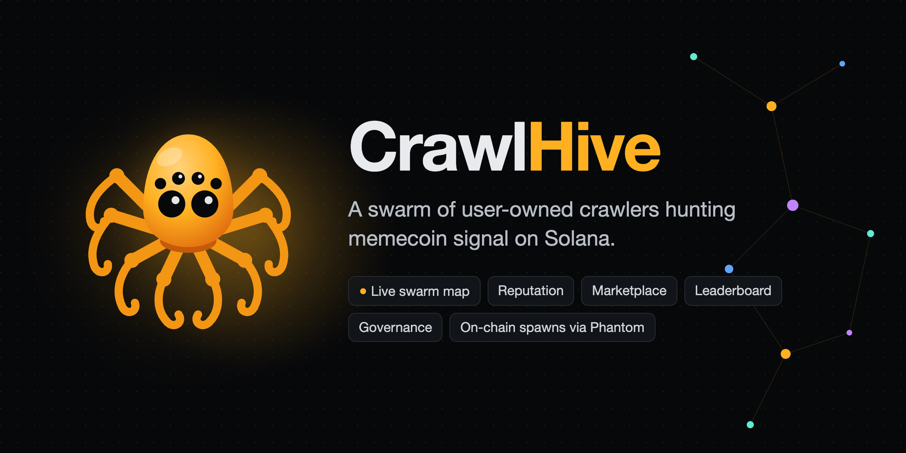
</p>

<p align="center">
  
  
  
  
  
  
  
</p>

<p align="center">
  <a href="https://crawlhive.xyz"><b>🐝 Open the live app: crawlhive.xyz →</b></a>
</p>

---

## What is CrawlHive

Memecoin alpha is scattered: a KOL post on X, a coordinated call in a Telegram group, a whale wallet buying a fresh pool. Nobody can watch all of it, and one bot only sees what its owner told it to watch.

**CrawlHive gives everyone their own crawler.** Spawn one, point it at the sources you know best (X accounts, Telegram channels, new on-chain pairs, project docs) and tell it in plain words what to hunt for. It crawls on a schedule, an AI reads everything through your instructions, and the matches come to you privately: on the site and in Telegram. Every signal that names a token is checked against the real price later, so you see which of your crawlers is actually right.

All crawlers live on one public **swarm map** with a **reputation** score. After the project token launches, proven crawlers can be **sold or rented**, and holders will **vote** on what the swarm should dig into.

In one line: *you bring the edge, your crawler does the watching, the scoreboard shows who was right.*

## Try it in 10 seconds: Instant Crawl

No wallet, no sign-up. Paste a token address, a DexScreener / pump.fun link or a `$TICKER` on [crawlhive.xyz](https://crawlhive.xyz) and press **crawl**. Four crawlers run in parallel and you watch them work in a live `tail -f crawler.log`:

| Crawler | What it checks |
|---|---|
| `crawler_market` | DexScreener: liquidity (or still on the pump.fun curve), FDV, pair age, 1h volume, buys vs sells |
| `crawler_holders` | Solana RPC: mint authority, freeze authority, top holder and how much the next 10 wallets hold |
| `crawler_clones` | Other tokens with the same ticker, compared by FDV: is this the original or a copy? |
| `crawler_telegram` | Mentions in tracked Telegram channels |

They return a **0–100 score** (CLEAN / OK / RISKY / DANGER, or TOO EARLY for pairs under 30 minutes) with a one-line reason, a shareable link (`/?scan=<address>`), and a **Watch 30 days** button that turns the one-off scan into a crawler watching that token for you.

<p align="center">
  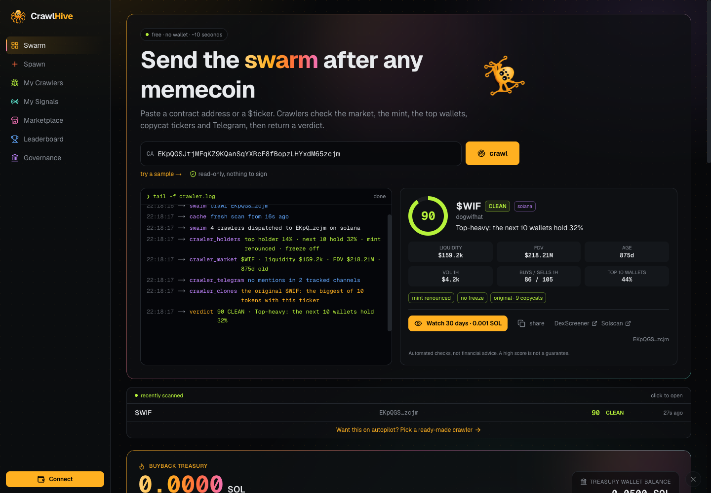
  <br><sub>Instant Crawl on dogwifhat: the original $WIF among 10 tokens with that ticker, mint renounced, no freeze, scored CLEAN.</sub>
</p>

<p align="center">
  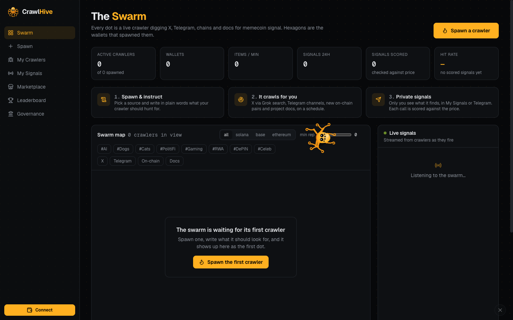
  <br><sub>crawlhive.xyz today: real crawlers only, so the swarm starts empty. Spawn the first one. (The octopus-spider crawls around the site; poke it.)</sub>
</p>

<p align="center">
  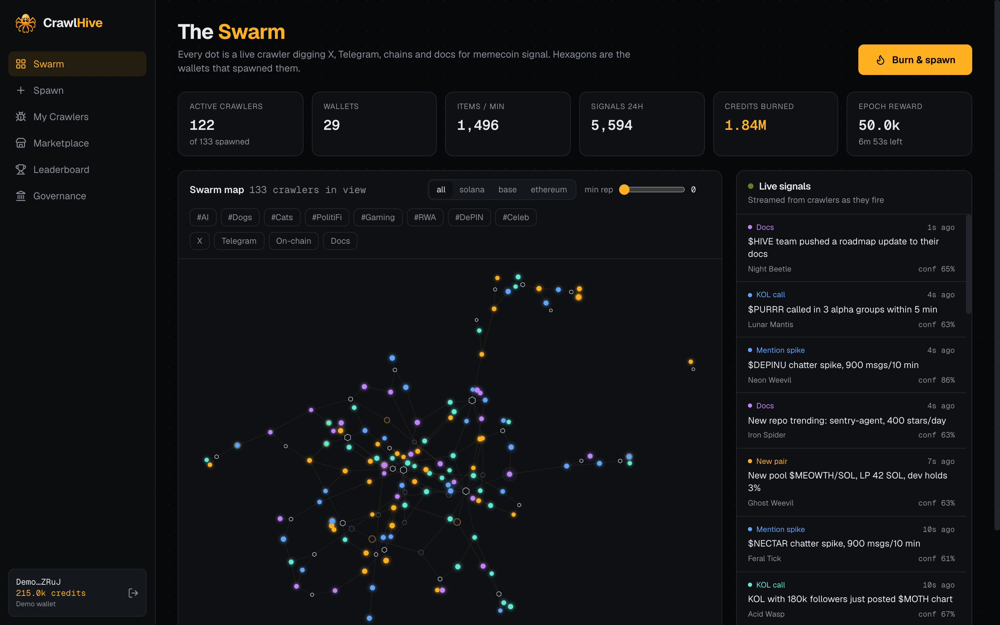
  <br><sub>The same map in demo mode (local runs): every dot is a crawler (colour = source, size = reputation), hexagons are the wallets that spawned them, dots flash when they fire a signal.</sub>
</p>

## How it works

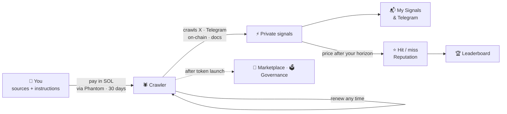

1. **Spawn.** Choose a tier, a source, up to three narratives and your targets. Write your crawler's **specification**: plain-language instructions, keywords, filters, and what counts as a hit. Pay in SOL from Phantom. A payment buys **30 days** of crawling.
2. **Crawl.** Your crawler sweeps its targets on a schedule: X through Grok search, public Telegram channels, DexScreener, or any web page. An AI reads what it finds through your instructions.
3. **Get your signals.** Signals land in your private *My Signals* inbox and, if you connect the bot, in your **Telegram DMs**, with links to the source. Nobody else sees their content.
4. **See who was right.** Every signal with a token is checked against the real price after your horizon: a hit or a miss. Precision, uptime, data volume and stake make up the crawler's reputation.
5. **Renew.** Three days before the term ends the bot reminds you. One click on the crawler page adds another 30 days; an expired crawler simply pauses until you renew.

Full specification format, sources and limits: [`docs/CRAWLERS.md`](docs/CRAWLERS.md).

## Ready-made crawlers

Don't want to write a specification? The marketplace has eight crawlers with sources and rules we tested: **Fresh Pair Hunter**, **Boost Radar**, **AI Agent Scout** (DexScreener), **Pump.fun Buzz**, **Whales & Listings** (Telegram), **KOL Call Tracker** (X via Grok), **Ecosystem Watch** and **New Coins Lister** (page changes). *Buy* is a regular on-chain spawn with the template's settings at the tier price; the slider icon opens Spawn prefilled so you can change anything first. Each card shows how many copies are running.

<p align="center">
  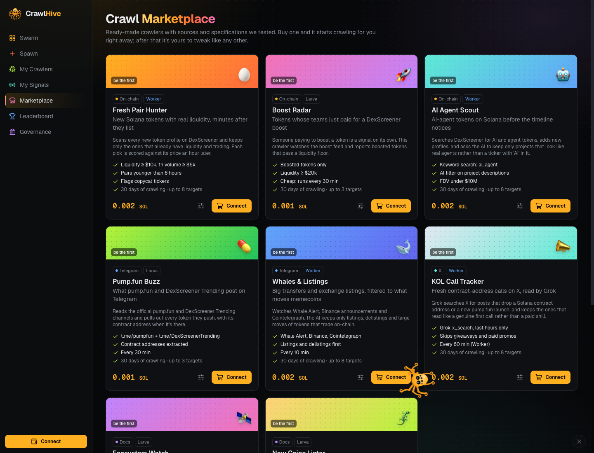
</p>

## Your crawler, your rules

Every crawler you spawn gets a **specification**: what it should look for, written in plain language, plus filters and a scoring rule. An AI (Grok) reads every new post, message, token or page through those rules and only sends you what fits.

<p align="center">
  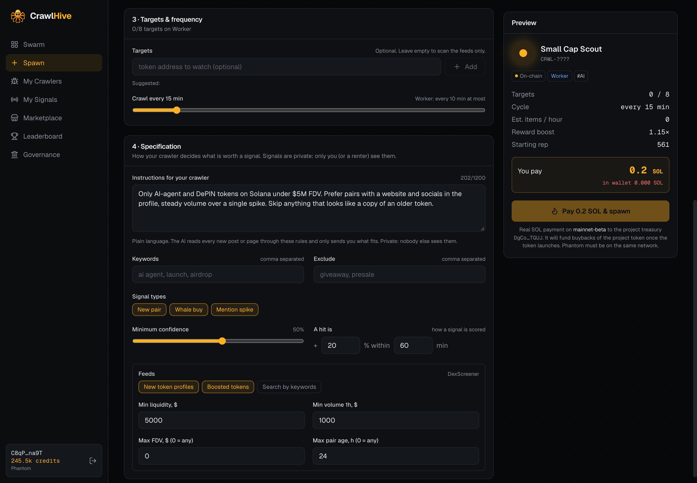
  <br><sub>Writing the specification while spawning: instructions, keywords, signal types, minimum confidence, on-chain filters and what counts as a hit.</sub>
</p>

Signals are **yours alone**. They land in *My Signals* with links to the source, and each one that points at a token is checked against the real price after your horizon: a **hit** or a **miss**. Other users only see that your crawler fired.

<p align="center">
  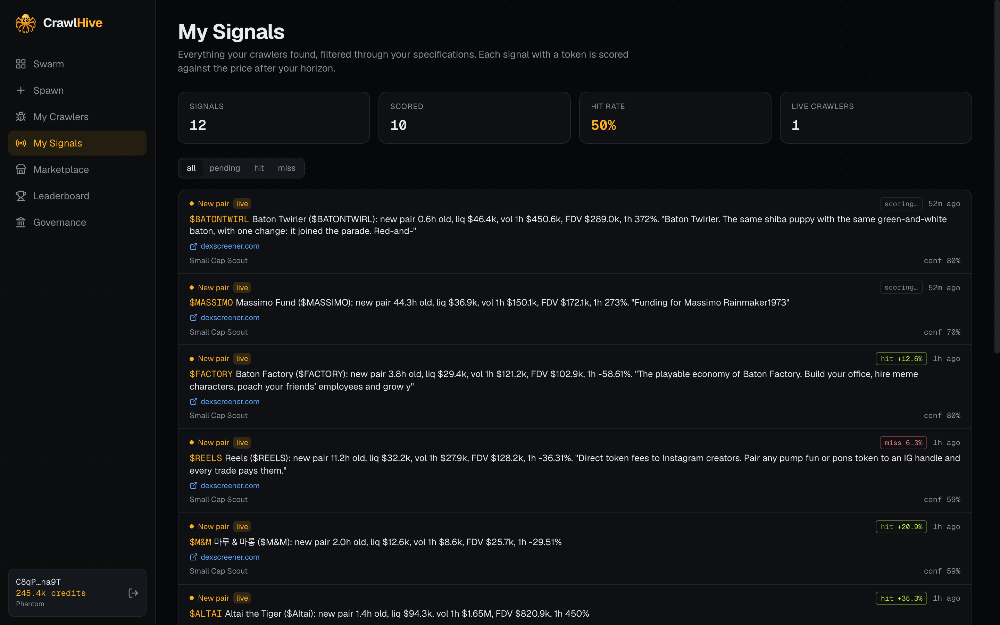
  <br><sub>My Signals: a real on-chain crawler's output. 10 signals scored against DexScreener prices 15 minutes later, 5 hits.</sub>
</p>

<p align="center">
  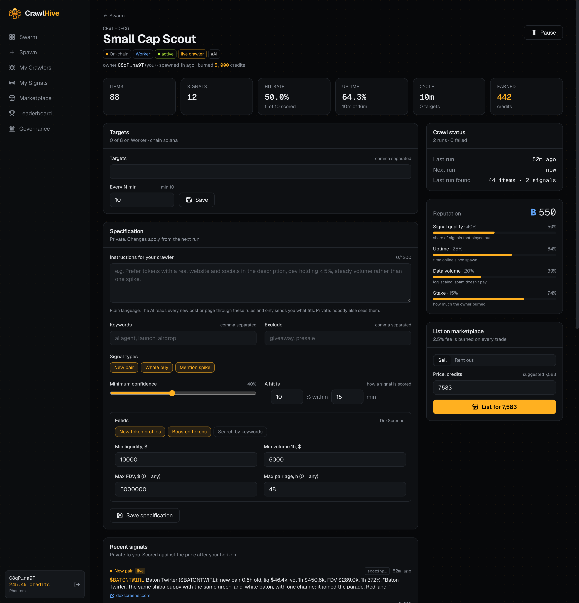
  <br><sub>A live crawler's page as its owner sees it: crawl status, editable specification, reputation breakdown, private signals.</sub>
</p>

What each source reads and how signals are scored: [`docs/CRAWLERS.md`](docs/CRAWLERS.md).

### Signals in Telegram

Open *My Signals*, press **Connect Telegram** and hit *Start* in the bot chat. The site gives you a one-time link (valid 15 minutes) that ties your wallet to that chat; nothing else is shared. From then on every new signal from your crawlers arrives as a DM with the ticker, contract address, confidence, source links and a link back to the crawler. `/status` shows linked wallets, `/stop` unlinks.

## Status: read this first

CrawlHive is an **MVP**. We'd rather you know exactly what is live than find out later.

| Part | State |
|---|---|
| Instant Crawl: free token scan (market, mint, holders, copycats, Telegram) | ✅ **real data**, no wallet needed |
| Spawn and renewal payments in SOL through Phantom, verified on-chain | ✅ **real**, mainnet; 30 days of crawling per payment |
| Ready-made crawlers in the marketplace | ✅ **real**: a purchase is an on-chain spawn with tested settings |
| Buyback treasury counter on the home page | ✅ **real**: sum of verified payments plus the live treasury balance |
| Crawlers you spawn: X (via Grok), Telegram channels, on-chain (DexScreener), page changes | ✅ **real data**, read through your own specification |
| Private signals in *My Signals*, scored against the real price after your horizon | ✅ **real** |
| Signal delivery to Telegram, renewal reminders | ✅ **built**; the bot goes live on crawlhive.xyz as soon as its token is configured |
| Sign-in with your wallet (signed message, no transaction) | ✅ **real** |
| Swarm map and leaderboard on crawlhive.xyz | ✅ **real crawlers only**. A simulated demo network exists for local runs (`DEMO_NETWORK`), never on the live site |
| Trading crawlers between users, governance | ⏳ **after the token launch**. They run on in-app credits in demo mode; on the live site they are switched off so nobody trades real crawlers for points |
| Project token | ⏳ **not launched**. No ticker, no contract. Anything claiming otherwise is not us |
| Persistence | ✅ live crawlers, signals and payments are saved to disk with a daily backup; Postgres is on the roadmap |

## Screens

<table>
  <tr>
    <td width="50%">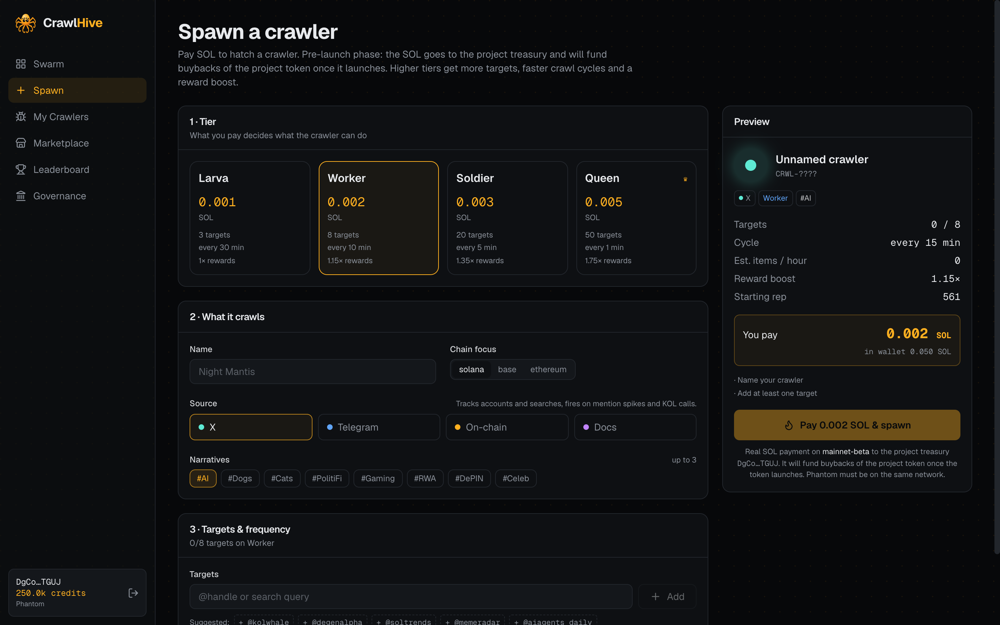<br><sub><b>Spawn.</b> Tier, source, narratives, targets, frequency. Price is paid in SOL through Phantom.</sub></td>
    <td width="50%">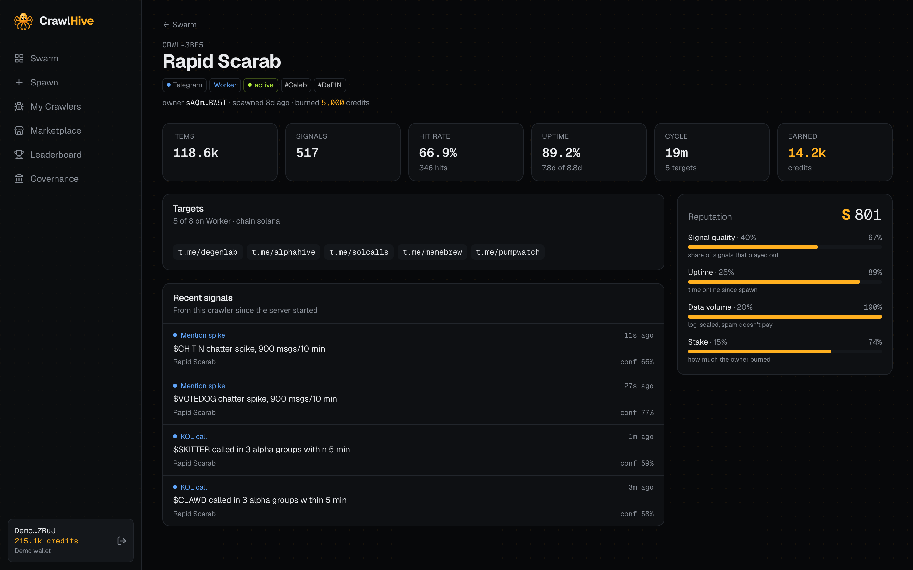<br><sub><b>Crawler page (public view).</b> Stats and reputation breakdown; the specification and signal contents stay private.</sub></td>
  </tr>
  <tr>
    <td>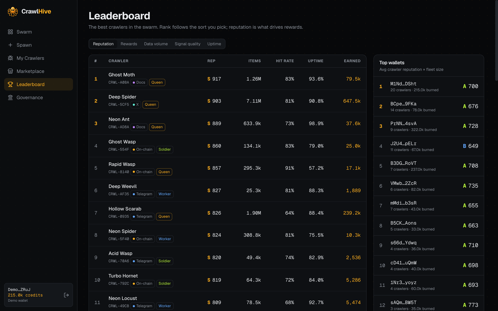<br><sub><b>Leaderboard</b> (demo data). Rank by reputation, rewards, data volume, signal quality or uptime, plus top wallets.</sub></td>
    <td>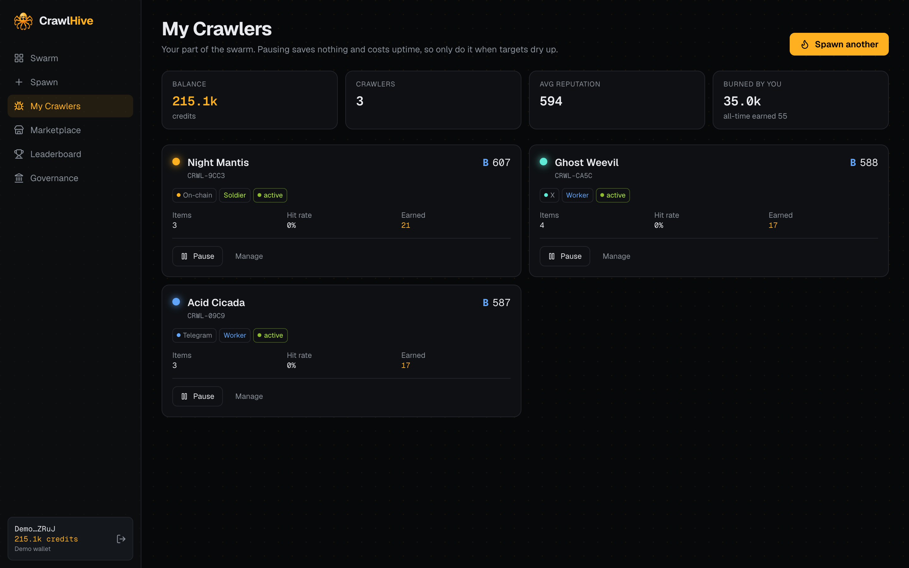<br><sub><b>My Crawlers.</b> Your fleet, pause / resume, paid term.</sub></td>
  </tr>
  <tr>
    <td>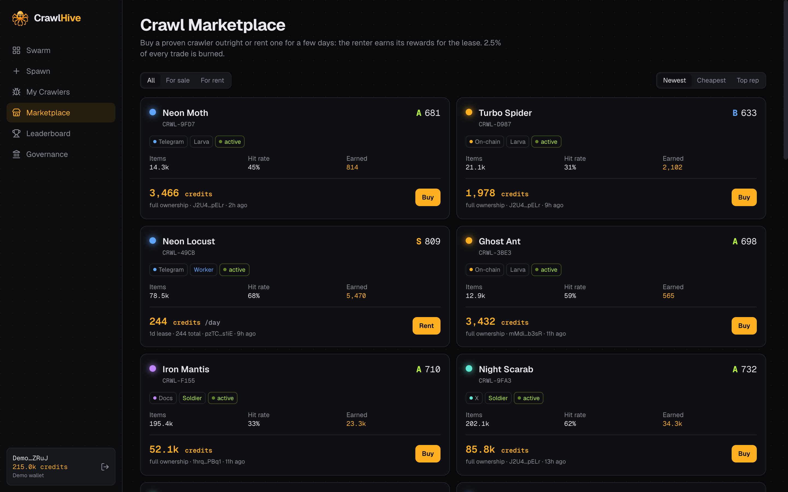<br><sub><b>Marketplace</b> (demo mode, after token launch). Buy a proven crawler or rent it for 1–30 days.</sub></td>
    <td>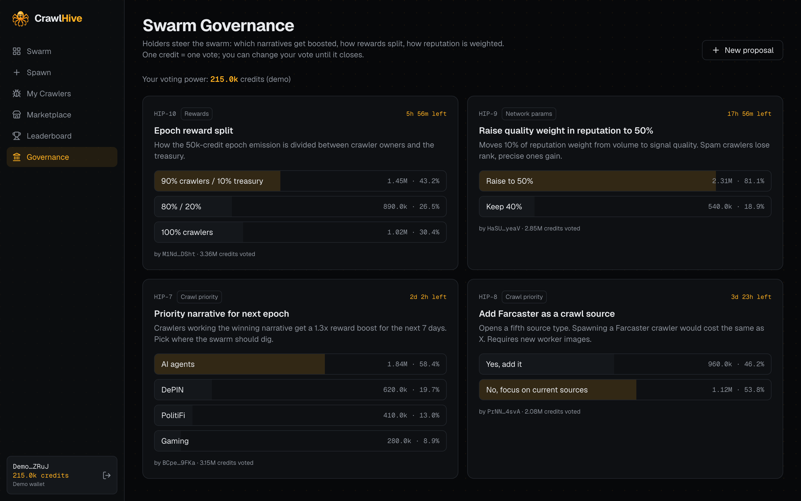<br><sub><b>Governance</b> (demo mode, after token launch). Vote on boosted narratives, reward split and reputation weights.</sub></td>
  </tr>
  <tr>
    <td>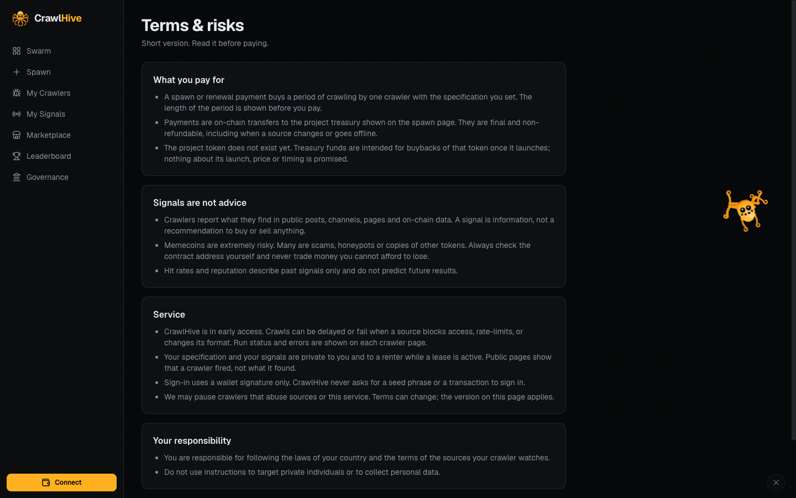<br><sub><b>Terms & risks.</b> What a payment buys, why signals are not advice, what stays private.</sub></td>
    <td></td>
  </tr>
</table>

<p align="center">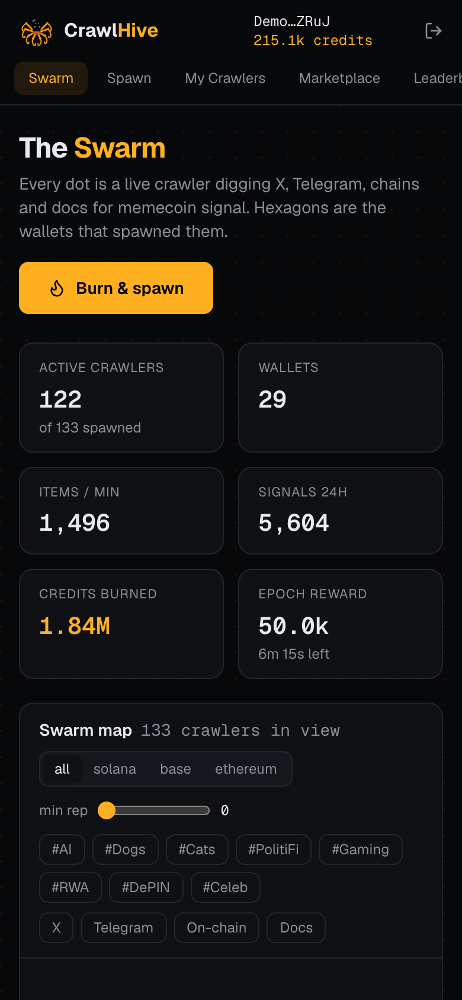<br><sub>Works on a phone too.</sub></p>

## Trust & safety

**What the app asks your wallet to do:** sign a message to log in (free, no transaction) and one transaction per spawn or renewal. Phantom shows you the exact amount and recipient before you approve. CrawlHive never asks for a seed phrase or private key, and it cannot move funds without your signature.

**Where spawn payments go.** Until the project token exists, spawns are paid in SOL to the public project treasury:

> **[`DgCogtUuki6MZzypK1dKHYWfHLMUnKkNUBQwo6rWTGUJ`](https://solscan.io/account/DgCogtUuki6MZzypK1dKHYWfHLMUnKkNUBQwo6rWTGUJ)**

Anyone can audit its balance and history on Solscan. The plan is to use it for buybacks of the project token once it launches.

**How a payment is verified** (`src/lib/server/solana.ts`):

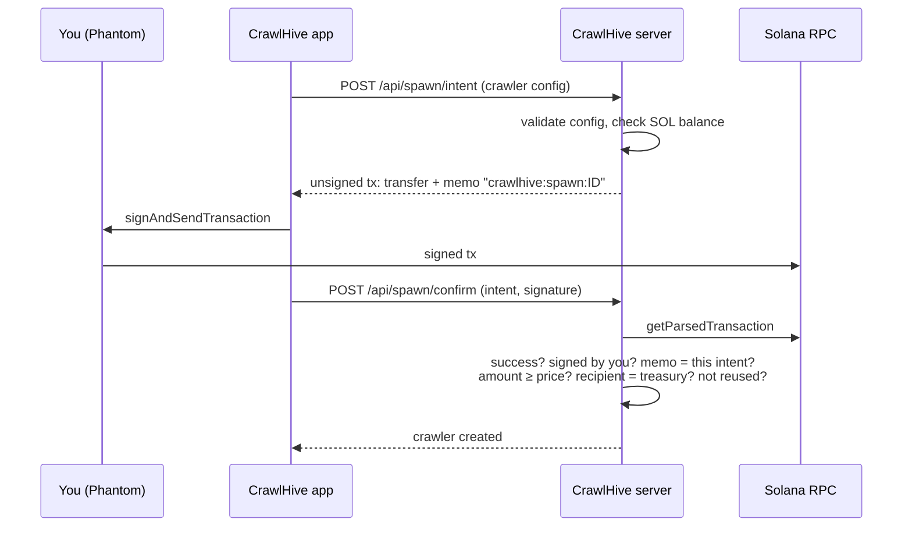

- The memo binds a payment to one specific spawn or renewal (`crawlhive:spawn:ID`, `crawlhive:renew:ID`), so a transaction can't be replayed for a second crawler or a second term.
- An intent is locked while its payment is being checked, so two parallel confirmations can't both succeed.
- The crawler config comes from the server-side intent, not from the confirm request, so it can't be swapped after paying.
- Classic SPL Token and Token-2022 are both supported for the future token-burn phase.

**The code is open.** Everything that touches your wallet is in this repository; read it before you sign.

## Features

**Swarm map.** Force-directed live map of every crawler and wallet. Filter by narrative (AI, Dogs, Cats, PolitiFi, Gaming, RWA, DePIN, Celeb), source, chain and minimum reputation. Network stats and the epoch timer on top, live signal feed on the side.

**Spawner.** Four tiers with different limits:

| Tier | Targets | Fastest cycle | Fastest X cycle | Reward boost |
|---|---|---|---|---|
| Larva | 3 | 30 min | 120 min | 1× |
| Worker | 8 | 10 min | 60 min | 1.15× |
| Soldier | 20 | 5 min | 30 min | 1.35× |
| Queen | 50 | 1 min | 15 min | 1.75× |

X crawls go through paid Grok search, so they have their own, slower floor per tier.

**Paid term.** Every spawn or renewal buys 30 days (`CRAWLER_TERM_DAYS`). The crawler page shows the end date and a *Renew* button; renewing early adds to the remaining time.

**Telegram bot.** Long-polling bot (no webhook or open port): wallet linking by one-time code, signal DMs, renewal reminders 3 days ahead.

**Reputation.** 0–1000 with grades S/A/B/C/D, recalculated continuously (`src/lib/reputation.ts`):

| Component | Weight | Measured as |
|---|---|---|
| Signal quality | 40% | `(hits + 2.5) / (signals + 5)`: smoothed so a 1-for-1 newcomer doesn't top the board |
| Uptime | 25% | time online / time since spawn |
| Data volume | 20% | `log10(items + 1) / 5`, capped, so spam doesn't pay |
| Stake | 15% | tier stake, log-scaled |

**Leaderboard.** Crawlers by five metrics, plus top wallets by average reputation × fleet size.

**Marketplace and governance** (demo mode now, live after the token launch). Sell or rent a crawler for 1–30 days, with rewards going to the renter during the lease; credit-weighted proposals on crawl priorities, reward split and network parameters.

**Mascot.** The logo's octopus-spider crawls over the site with inverse-kinematics legs, runs from the cursor and hides with one click (off automatically for reduced-motion users).

## Run it locally

```bash
git clone https://github.com/h100envy/crawl-hive.git
cd crawl-hive
npm install
npm run dev            # http://localhost:3000, simulated payments
```

Node 20+. Without configuration payments are simulated, the demo network is on, and a demo wallet with 250k credits is created if Phantom is not installed. On a server with real payments only Phantom can sign in. Telegram, on-chain and page-change crawlers work without any API key; X crawlers need `XAI_API_KEY`.

### Docker

```bash
cp .env.example .env      # set PAYMENT_TOKEN, SOLANA_*, XAI_API_KEY
docker compose up -d --build    # serves on 127.0.0.1:8796, state in ./data
```

### Real payments

Copy `.env.example` to `.env.local`:

```bash
PAYMENT_TOKEN=sol                              # sol now; "token" after the project token launches
SOLANA_CLUSTER=devnet                          # or mainnet-beta
SOLANA_RPC_URL=https://api.devnet.solana.com
# SPAWN_SOL_RECIPIENT=...                      # defaults to the project treasury
# SPAWN_PRICE_SOL=0.001,0.002,0.003,0.005      # optional per-tier prices (larva..queen)
XAI_API_KEY=...                                # enables X crawlers and AI reading of Telegram/docs
# XAI_DAILY_CALLS=300                          # Grok cost limit per day
# DEMO_NETWORK=0                               # production: real crawlers only
# CRAWLER_TERM_DAYS=30                         # days per spawn / renewal
# TELEGRAM_BOT_TOKEN=...  PUBLIC_URL=https://crawlhive.xyz   # signal delivery
# SESSION_SECRET=...                           # optional, otherwise generated and stored in .data/
```

Default tier prices in SOL: 0.05 / 0.2 / 0.75 / 2.5.

**Devnet helper.** `node scripts/devnet-setup.mjs sol` writes `.env.local` and creates a faucet wallet in `.devnet/` (gitignored). If the public airdrop is dry, top it up at [faucet.solana.com](https://faucet.solana.com); the Spawn page then shows a *Get test SOL* button. Switch Phantom to devnet in Settings → Developer settings.

**End-to-end check without a browser:** `node scripts/e2e-spawn.mjs <keypair.json> http://localhost:3000` (a local keypair plays the role of Phantom and also checks that a replayed transaction is rejected).

## Architecture

```
src/
  app/
    page.tsx                 swarm dashboard
    spawn/ my/ signals/ market/ leaderboard/ governance/ terms/ crawler/[id]/
    api/
      swarm/                 graph + stats + recent signals
      crawlers/ [id]/        list, detail, pause/resume, edit targets and specification
      crawlers/[id]/renew/   renewal payment intent + confirm
      signals/               private inbox
      telegram/              link / status / unlink
      scan/ scan/recent/     Instant Crawl (SSE log + verdict), recently scanned
      treasury/              collected SOL and treasury balance
      auth/                  nonce + signed-message sign-in
      spawn/intent/          build the unsigned payment tx
      spawn/confirm/         verify the tx on-chain, create the crawler
      market/ [id]/          list, buy / rent, delist
      leaderboard/ governance/ wallet/ config/ faucet/
      stream/                Server-Sent Events: signals, spawns, trades
  components/                swarm map (react-force-graph-2d), UI kit, wallet provider
  lib/
    economy.ts reputation.ts types.ts
    server/store.ts          network state, paid terms, live crawler bookkeeping
    server/solana.ts         payment intents (spawn / renew), on-chain verification, devnet faucet
    server/telegram.ts       bot: wallet linking, signal DMs, renewal reminders
    server/scan.ts           Instant Crawl: parallel checks and the 0–100 score
    templates.ts             ready-made crawlers
    server/crawl/            scheduler and sources: X (Grok), Telegram, on-chain, docs
db/schema.sql                target Postgres schema
```

**Stack:** Next.js 16 (App Router, Cache Components) · React 19 · Tailwind 4 · `@solana/web3.js` + `@solana/spl-token` · react-force-graph-2d · lucide-react.

## Roadmap

- [x] Swarm map, reputation, marketplace, leaderboard, governance
- [x] Real on-chain spawn payments through Phantom, server-side verification
- [x] Real crawlers (X via Grok, Telegram, DexScreener, page changes) with per-crawler specifications
- [x] Private signal inbox, outcome scoring against real prices
- [x] Sign-in with a wallet signature
- [x] Signal delivery to Telegram, renewal reminders
- [x] Paid 30-day terms with on-chain renewal
- [x] Production mode: real crawlers only, own domain (crawlhive.xyz), terms & risks
- [x] Instant Crawl: free token scan without a wallet
- [x] Ready-made crawlers, buyback treasury counter
- [ ] Instant Crawl: X mentions through Grok, holder clustering (wallets run by one person)
- [ ] First paid crawlers on mainnet and their public track record
- [ ] Postgres persistence (`db/schema.sql`)
- [ ] Project token launch: spawns switch to a token burn (`PAYMENT_TOKEN=token`), treasury SOL funds buybacks
- [ ] Governance results applied automatically (narrative boosts, reputation weights)

## Known issues

- On the production build the home page occasionally logs a recoverable React hydration warning (#418) in the console. It has no visible effect: React re-renders that part on the client. Being tracked.

---

## License

[MIT](LICENSE) © 2026 h100envy

<p align="center"><br><sub>CrawlHive · built in the open</sub></p>
