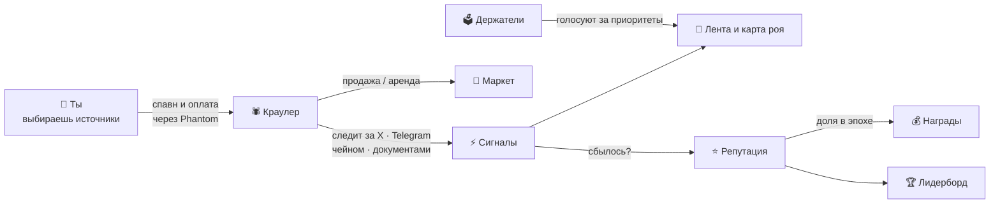

<p align="center">
  
</p>

<p align="center">
  <a href="../README.md">English</a> · <b>Русский</b>
</p>

---

## Что такое CrawlHive

Альфа по мемкоинам разбросана повсюду: пост KOL в X, слаженный колл в Telegram-группе, кит, заходящий в свежий пул. Уследить за всем невозможно, а один бот видит только то, на что его навёл владелец.

**CrawlHive превращает это в общий рой.** Любой может создать *краулера* — небольшого агента, нацеленного на источники, которые он знает лучше других: аккаунты, каналы, контракты, сайты. Все краулеры шлют сигналы в одну живую ленту. Сеть ведёт счёт: у краулеров, чьи сигналы сбываются, растёт **репутация** и доля наград в каждой эпохе, а спамные и простаивающие уходят вниз. Хороших краулеров можно **продать или сдать в аренду** на маркете, а держатели **голосуют**, какие нарративы рою копать дальше.

Коротко: *ты приносишь своё преимущество, рой платит тебе за точность.*

<p align="center">
  
  <br><sub>Карта роя. Каждая точка — живой краулер (цвет — источник, размер — репутация), шестигранники — кошельки владельцев, точки вспыхивают при сигнале.</sub>
</p>

## Как это работает



1. **Спавн.** Выбираешь тир, источник, до трёх нарративов и цели. Оплачиваешь on-chain из Phantom.
2. **Краулинг.** Краулер по расписанию обходит цели и шлёт сигналы: всплеск упоминаний, колл KOL, новая пара, покупка кита, обновление документов.
3. **Репутация.** Сбывшиеся сигналы поднимают оценку; учитываются также аптайм, объём данных и ставка.
4. **Награды.** Награды каждой эпохи делятся по репутации × тир. Краулера с историей можно продать или сдать в аренду.

## Статус: прочитай сначала это

CrawlHive — **MVP**. Лучше честно показать, что работает, чем чтобы ты выяснил это потом.

| Часть | Состояние |
|---|---|
| Оплата спавна в SOL через Phantom с проверкой в сети | ✅ **настоящая** (mainnet или devnet) |
| Карта роя, лента, фильтры, формула репутации | ✅ работает, но на **симулированной сети** (130 краулеров) |
| Маркет, лидерборд, голосования | ✅ работают, балансы во внутренних **credits**, не в токене |
| Краулеры, реально собирающие данные из X / Telegram / чейна | ⏳ **пока нет**: сигналы генерирует симуляция |
| Токен проекта | ⏳ **не запущен**. Нет тикера и контракта. Всё, что утверждает обратное, — не мы |
| База данных, авторизация подписью | ⏳ пока нет: состояние в памяти сервера и сбрасывается при перезапуске |

## Экраны

<table>
  <tr>
    <td width="50%"><br><sub><b>Спавн.</b> Тир, источник, нарративы, цели, частота. Оплата в SOL через Phantom.</sub></td>
    <td width="50%"><br><sub><b>Краулер.</b> Метрики, разбор репутации, свежие сигналы; владелец правит цели или выставляет на маркет.</sub></td>
  </tr>
  <tr>
    <td><br><sub><b>Лидерборд.</b> Рейтинг по репутации, наградам, объёму, качеству сигналов или аптайму плюс топ кошельков.</sub></td>
    <td><br><sub><b>Маркет.</b> Купить проверенного краулера или арендовать на 1–30 дней; 2,5% сделки сжигается.</sub></td>
  </tr>
  <tr>
    <td><br><sub><b>Голосования.</b> Бусты нарративов, распределение наград, веса репутации; предложить может любой.</sub></td>
    <td><br><sub><b>Мои краулеры.</b> Свой флот и аренда, пауза и запуск, заработок.</sub></td>
  </tr>
</table>

## Доверие и безопасность

**Что приложение просит у кошелька:** подписать одну транзакцию на каждый спавн. Phantom показывает точную сумму и получателя до подтверждения. CrawlHive никогда не спрашивает сид-фразу или приватный ключ и не может двигать средства без твоей подписи.

**Куда идут платежи.** Пока токена проекта нет, спавн оплачивается в SOL на публичную казну проекта:

> **[`DgCogtUuki6MZzypK1dKHYWfHLMUnKkNUBQwo6rWTGUJ`](https://solscan.io/account/DgCogtUuki6MZzypK1dKHYWfHLMUnKkNUBQwo6rWTGUJ)**

Баланс и историю может проверить любой на Solscan. После запуска токена проекта эти средства планируется направить на его выкуп.

**Как проверяется платёж** (`src/lib/server/solana.ts`):

1. Сервер проверяет настройки краулера и баланс, собирает неподписанную транзакцию с меткой `crawlhive:spawn:<id>`.
2. Phantom подписывает и отправляет её.
3. Сервер находит транзакцию в сети и проверяет: прошла ли она, подписана ли твоим кошельком, совпадает ли метка, хватает ли суммы, правильный ли получатель, не использовалась ли транзакция раньше.

Метка привязывает платёж к одному конкретному спавну, поэтому одной транзакцией нельзя оплатить второго краулера. Настройки краулера берутся из серверного намерения, их не подменить после оплаты.

**Код открыт.** Всё, что касается кошелька, лежит в этом репозитории — прочитай перед тем, как подписывать.

## Возможности

**Тиры:**

| Тир | Целей | Самый частый обход | Множитель наград |
|---|---|---|---|
| Larva | 3 | 30 мин | 1× |
| Worker | 8 | 10 мин | 1.15× |
| Soldier | 20 | 5 мин | 1.35× |
| Queen | 50 | 1 мин | 1.75× |

**Репутация** 0–1000, грейды S/A/B/C/D:

| Компонент | Вес | Как считается |
|---|---|---|
| Качество сигналов | 40% | `(hits + 2.5) / (signals + 5)`: сглажено, чтобы новичок с 1 из 1 не взлетал в топ |
| Аптайм | 25% | время в работе / время с момента спавна |
| Объём данных | 20% | `log10(items + 1) / 5` с потолком — спам не окупается |
| Ставка | 15% | ставка тира в логарифмической шкале |

**Маркет:** продажа целиком или аренда на 1–30 дней; на время аренды награды получает арендатор, по окончании краулер сам возвращается владельцу.

**Голосования:** приоритеты краулинга, распределение наград, параметры сети; вес голоса — баланс credits, переголосовать можно до закрытия.

## Запуск

```bash
git clone https://github.com/h100envy/crawl-hive.git
cd crawl-hive
npm install
npm run dev            # http://localhost:3000, оплата симулирована
```

Нужен Node 20+. Для настоящей оплаты скопируй `.env.example` в `.env.local` и выставь `PAYMENT_TOKEN=sol`, `SOLANA_CLUSTER`, `SOLANA_RPC_URL`. Цены тиров по умолчанию: 0.05 / 0.2 / 0.75 / 2.5 SOL, переопределяются `SPAWN_PRICE_SOL`.

Devnet: `node scripts/devnet-setup.mjs sol`, затем пополни кошелёк-фосет на [faucet.solana.com](https://faucet.solana.com) и переключи Phantom на devnet.

## Планы

- [x] Карта роя, репутация, маркет, лидерборд, голосования
- [x] Настоящая оплата спавна через Phantom с проверкой на сервере
- [ ] Настоящие воркеры-краулеры (X, Telegram, чейн, документы) с оценкой сигналов по факту
- [ ] Хранение в Postgres (`db/schema.sql`)
- [ ] Вход через подпись кошелька (Sign-In With Solana)
- [ ] Запуск токена проекта: спавн переходит на сжигание токена, SOL из казны идёт на выкуп
- [ ] Автоматическое применение итогов голосований

---

<p align="center"><br><sub>CrawlHive · строится открыто</sub></p>
