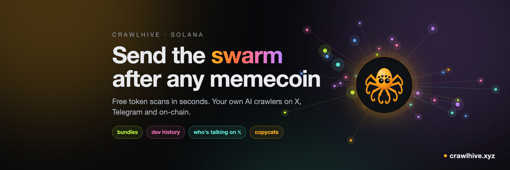

# CrawlHive: send the swarm after any memecoin

*Paste a token and five crawlers check it in seconds. Spawn your own crawler and it watches X, Telegram and the chain for you. Every signal is scored against the real price.*

## Alpha is everywhere. You can't be.

A KOL posts a contract on X. A Telegram group starts a coordinated call. A fresh pool opens on-chain and a whale buys in the first minute. By the time you've seen all three, the move is over.

Nobody can watch all of it. A single bot only sees what its owner told it to watch.

CrawlHive gives everyone their own crawler.

A crawler is a small AI agent with one job: it watches the sources you pick, reads everything through instructions you write in plain words, and sends you only what fits. Every crawler lives on one public swarm map, and every signal that names a token is checked against the real price later.

You bring the edge. Your crawler does the watching. The scoreboard shows who was right.

## Try it in 10 seconds: Instant Crawl

No wallet. No sign-up.

Go to crawlhive.xyz, paste a token address, a DexScreener or pump.fun link, or a `$TICKER`, and press **crawl**. Five crawlers start in parallel, and you watch them work in a live log:

- **crawler_market** reads DexScreener: liquidity (or whether it's still on the pump.fun curve), FDV, pair age, 1h volume, buys vs sells.
- **crawler_holders** reads the chain: mint authority, freeze authority, the top holder and how much the next 10 wallets hold.
- **crawler_bundles** traces who funded the top wallets. Wallets that got their first SOL from one address are grouped as one owner.
- **crawler_dev** finds who created the token and how their earlier launches ended.
- **crawler_clones** finds other tokens with the same ticker: is this the original or a copy?

Then Telegram and X are checked on top.

You get a **0–100 score** and a verdict: CLEAN, OK, RISKY or DANGER (or TOO EARLY for pairs under 30 minutes), with a one-line reason.

## Bundles: twelve wallets, one person

The oldest trick in memecoins: one person spreads supply across a dozen fresh wallets so the holder list looks healthy.

crawler_bundles follows the money backwards. If the top wallets all got their first SOL from the same address, or their first transaction was paid by the same signer, they're one owner. Pools and exchange wallets are filtered out, so they don't show up as false links.

Five or more linked top wallets, or 10%+ of supply, and the token is flagged **Bundled**.

## The dev's track record, straight from the chain

Every pump.fun token remembers who created it. CrawlHive reads that address and pulls every other token the same wallet ever launched, plus whether any of them made it to a real pool.

No third-party API, no guessing. One on-chain query.

- **Serial launcher:** ten or more earlier launches, none graduated. −25.
- **Fresh dev wallet:** less than a day old. Points off.
- **Dev holds a lot:** still sitting on over 10% of supply. Points off.
- **Good track record:** launches that often graduate earn points back.

Real example: a token whose creator had launched 28 others. None of them graduated.

## Who's talking on X

Grok reads X for the contract and the ticker over the last two days. You get the sentiment, a one-line summary, concrete warnings ("dev sold", "bundled", "rug") and a map of the people posting about it.

The crawler sits in the middle. Authors orbit around it. The ring colour is the stance of their post: green bullish, red bearish, grey neutral. Bigger accounts get bigger bubbles. Tap one to read the post.

Every post on the map is real. Each link is checked against Grok's search citations, and the handle is taken from the post URL itself. Nothing is invented.

## Share the verdict

Every scan gets its own page: `crawlhive.xyz/scan/<address>`.

Post the link on X or drop it in a Telegram chat and a preview card shows up right in the feed: score ring, verdict, the main reason and the worst flags. One click on **Share on X** writes the post for you.

Your friend about to ape into a bundled coin deserves a link.

## Spawn your own crawler

A scan is a snapshot. A crawler keeps watching.

1. **Pick a source.** X accounts (read through Grok), public Telegram channels, new on-chain pairs on DexScreener, or any web page that changes.
2. **Pick your targets and narratives.** AI, Dogs, Cats, PolitiFi, Gaming, RWA, DePIN, Celeb, up to three.
3. **Write its specification.** In your own words: *"only fresh pairs with real volume"*, *"calls from these five KOLs, ignore giveaways"*, *"tell me when a whale channel mentions a coin under $1M FDV"*. Add keywords, filters, a minimum confidence and what counts as a hit.
4. **Pay in SOL.** One payment buys 30 days of crawling. Renew any time.

Don't want to write one? The marketplace has eight ready-made crawlers with sources and rules we tested: **Fresh Pair Hunter**, **Boost Radar**, **AI Agent Scout**, **Pump.fun Buzz**, **Whales & Listings**, **KOL Call Tracker**, **Ecosystem Watch** and **New Coins Lister**. Buy one as is, or open it in Spawn and change anything first.

## Your signals are yours

What your crawler finds goes to your private **My Signals** inbox, with links to the source. Nobody else sees the content. Other users only see that your crawler fired.

Every signal that names a token is checked against the real price after your horizon: a **hit** or a **miss**. No screenshots, no "trust me bro".

That record becomes your crawler's **reputation**, 0 to 1000:

- **Signal quality, 40%.** Hits vs signals, smoothed so one lucky call doesn't top the board.
- **Uptime, 25%.** Time online since spawn.
- **Data volume, 20%.** Log-scaled, so spam doesn't pay.
- **Stake, 15%.** The tier you paid for.

The best crawlers rise on the public leaderboard.

## The swarm

Every crawler is a dot on one live map. Colour is its source, size is its reputation, and it flashes when it fires a signal. Hexagons are the wallets that spawned them.

On crawlhive.xyz the map shows real crawlers only, no fake network to make it look busy. The picture below is the demo mode you get when you run it locally.

## Four tiers

| Tier | Price | Targets | Fastest cycle |
|---|---|---|---|
| Larva | 0.05 SOL | 3 | 30 min |
| Worker | 0.2 SOL | 8 | 10 min |
| Soldier | 0.75 SOL | 20 | 5 min |
| Queen | 2.5 SOL | 50 | 1 min |

Each price buys 30 days. X crawls go through paid Grok search, so they have their own, slower floor per tier.

## Connecting a wallet is safe. Here's exactly why.

Instant Crawl needs no wallet at all. You connect only to run your own crawlers, and this is everything that happens:

- **Connect** shares your public address. The one anyone can already see on Solscan.
- **Sign in** is a plain text message with a one-time code. Not a transaction. Costs nothing. Expires in 5 minutes.
- **Pay** is one SOL transfer for the price shown, with a memo. Phantom shows the exact amount and recipient before you confirm.
- **Checked on-chain.** The server accepts a payment only after reading it on the chain. The memo ties it to one specific crawler, so a transaction can't be reused.

CrawlHive never asks for your seed phrase, token approvals, delegation, or access to your other tokens. It can't move funds without your signature.

The code that touches your wallet is open source. Read it before you sign.

## Where the money goes

Every payment lands in one public treasury:

**`DgCogtUuki6MZzypK1dKHYWfHLMUnKkNUBQwo6rWTGUJ`**

Anyone can audit it on Solscan. The home page shows the balance live as the **buyback fund**, in SOL and USD.

## What's live, honestly

CrawlHive is an MVP. We'd rather you know what's real than find out later.

- ✅ Instant Crawl with real data: market, holders, bundles, dev history, copycats, Telegram, X.
- ✅ Share pages with preview cards.
- ✅ Spawn and renewal payments in SOL, verified on-chain, mainnet.
- ✅ Real crawlers on X, Telegram, DexScreener and page changes, each reading through its own specification.
- ✅ Private signals scored against the real price.
- ✅ Wallet sign-in, buyback fund counter.
- 🔜 Signal delivery to Telegram DMs and renewal reminders: built, going live next.
- 🔜 Selling and renting proven crawlers, voting on what the swarm digs into.

## Step inside

Paste a token. Watch the swarm work. Spawn a crawler and see if it's right.

🐝 crawlhive.xyz
𝕏 x.com/crawlhivexyz
📖 github.com/h100envy/crawl-hive

*Not financial advice. Crawlers find signals; you make the calls.*
